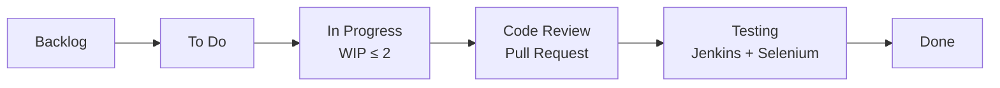
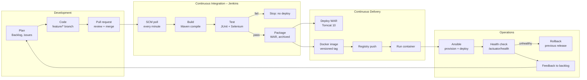

# Task 2 – Agile Planning and DevOps Workflow

## 1. User stories and acceptance criteria

| ID | User story | Acceptance criteria (Given / When / Then) | Priority | Points |
|---|---|---|---|---|
| US1 | As a **visitor**, I want to register with my name, email and phone so that I can book classes. | Given valid details, when I submit, then my account is created, I am signed in and see "Welcome, &lt;name&gt;". Given an email that already exists, then I see an error and no duplicate is created. Invalid email or phone shows a field error. | Must | 3 |
| US2 | As a **member**, I want to see upcoming classes with seats left so that I can pick one that has space. | When I open *Classes*, I see title, instructor, level, date/time and seats left for every upcoming slot. Full classes show "Full" and cannot be booked. | Must | 3 |
| US3 | As a **member**, I want to request a booking so that my seat is held. | When I click *Book* on a class with seats, a booking with a unique reference (YB-XXXXXX) is created with status REQUESTED, and seats left drops by 1. I cannot hold two active bookings for the same class. | Must | 5 |
| US4 | As a **member**, I want to confirm my requested booking so that the studio knows I'm coming. | Given a REQUESTED booking I own, when I click *Confirm*, the status becomes CONFIRMED. Confirming a cancelled booking is rejected. | Must | 2 |
| US5 | As a **member**, I want to cancel a booking so that someone else can take my seat. | Given a REQUESTED or CONFIRMED booking I own, when I click *Cancel*, the status becomes CANCELLED and seats left goes back up by 1. | Must | 3 |
| US6 | As a **member or front-desk user**, I want to track a booking by its reference so that I know its current status. | When I enter a valid reference on *Track Status*, I see class, member and status. An unknown reference shows "No booking found". *My Bookings* lists all my bookings with status. | Must | 3 |
| US7 | As an **ops engineer**, I want every commit built, tested and deployed automatically so that releases are repeatable. | A push to `main` triggers Jenkins. A failing test stops the pipeline before deployment. A green run deploys to Tomcat and Docker. | Must | 8 |
| US8 | As an **ops engineer**, I want the server configured by code so that I can rebuild or roll back quickly. | The Ansible playbook provisions a clean node. A second run reports `changed=0`. Rollback restores the previous release with health UP. | Should | 5 |

## 2. Product backlog – 15 tasks (T01–T15)

| Task | Backlog item | Story | DevOps task | Status |
|---|---|---|---|---|
| T01 | Problem statement, stakeholders, MVP scope | – | Task 1 | To do |
| T02 | User stories, backlog, sprint plan, DoD, workflow diagram | – | Task 2 | To do |
| T03 | SRS, architecture, data model, API list, local setup | – | Task 3 | To do |
| T04 | GitHub repo, README, .gitignore, templates, branch policy | – | Task 4 | To do |
| T05 | Member registration and sign-in | US1 | Task 5 | To do |
| T06 | Slot catalogue with live seats | US2 | Task 5 | To do |
| T07 | Booking request with seat hold | US3 | Task 5 | To do |
| T08 | Booking confirmation + cancellation | US4, US5 | Task 6 | To do |
| T09 | Status tracking page and REST API | US6 | Task 6 | To do |
| T10 | Jenkins CI job with polling + archived WAR | US7 | Task 7 | To do |
| T11 | Jenkinsfile + Tomcat deployment (parameterised) | US7 | Task 8 | To do |
| T12 | Selenium suite (5 journeys) + Jenkins test gate | US7 | Tasks 9–10 | To do |
| T13 | Dockerfile + container lifecycle | US7 | Task 11 | To do |
| T14 | Jenkins → Docker registry → container CD | US7 | Task 12 | To do |
| T15 | Ansible provisioning, idempotency, health check, rollback | US8 | Tasks 13–14 | To do |

## 3. Sprint plan (Scrum, 1-week sprints)

| Sprint | Goal | Backlog tasks | Demo at sprint review |
|---|---|---|---|
| Sprint 0 | Shared understanding and setup | T01, T02, T03, T04 | Approved scope, SRS, GitHub repo |
| Sprint 1 | First booking journey | T05, T06, T07 | Register → view slots → request booking (PR #1) |
| Sprint 2 | Complete MVP and release v1.0.0 | T08, T09 | Confirm / cancel / track, merge conflict resolved, tag v1.0.0 |
| Sprint 3 | Continuous integration and delivery | T10, T11, T12 | Jenkins builds, Selenium gate, deployment to Tomcat |
| Sprint 4 | Containers and configuration as code | T13, T14, T15 | Docker CD, Ansible provisioning, rollback, tag v1.1.0 |

## 4. Kanban task board

Columns: **Backlog → To Do → In Progress → Code Review (PR) → Testing (Jenkins) → Done**.
WIP limit: 2 in *In Progress*. Each card is a GitHub issue. Issues are linked from pull requests
(`Closes #n`) and close automatically when the release PR merges into `main`.

## 5. Definition of Done

A backlog item is **Done** only when:

1. The code is on a `feature/*` branch and merged to `develop` through a pull request.
2. The PR has a review comment and a description that links its issue.
3. `mvn clean package` succeeds with no compile errors.
4. Unit tests and the Selenium suite pass in Jenkins. A red test means *not done*.
5. The pipeline has deployed the build to Tomcat and the health check `/actuator/health` returns `UP`.
6. Any new configuration is in code (Jenkinsfile, Dockerfile or Ansible), not done by hand.
7. Documentation in `docs/` and the README is updated, and the GitHub issue is closed.

## 6. DevOps lifecycle – from development to operations

