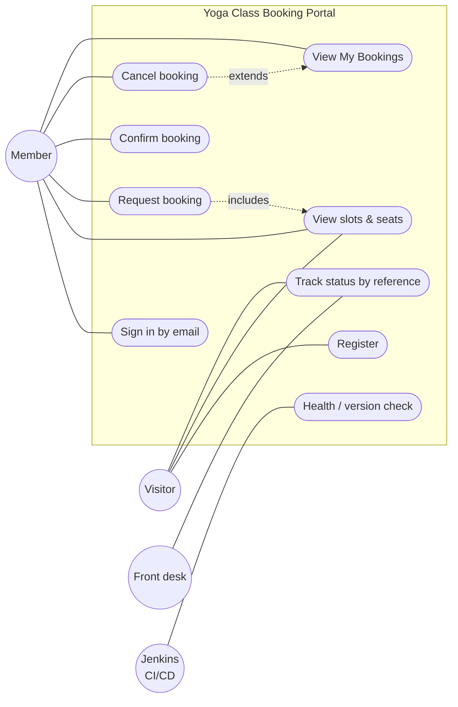
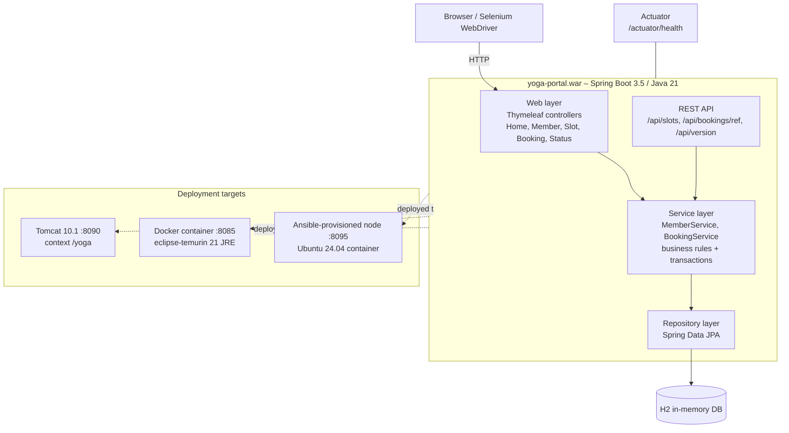
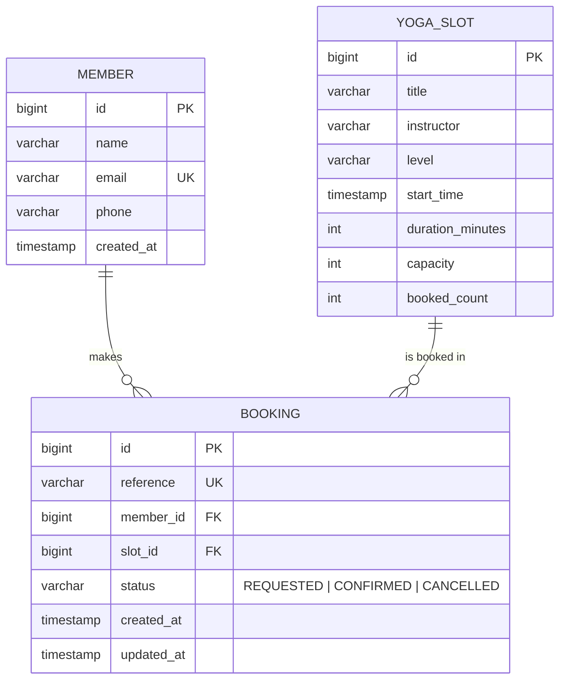

# Task 3 – Requirements, Architecture and Technology Setup

## 1. SRS summary

**Purpose.** Let members of Prana Studio book yoga classes online, and give the studio an automated
build, test and deploy pipeline.

**Scope.** The six MVP functions frozen in Task 1: registration, slot view, booking request,
confirmation, cancellation and status tracking.

### Functional requirements

| ID | Requirement |
|---|---|
| FR1 | The system shall register a member with name, email (unique) and phone, and start a session. |
| FR2 | The system shall let an existing member sign in with their email. |
| FR3 | The system shall list upcoming yoga slots with title, instructor, level, start time, duration and seats left. |
| FR4 | The system shall create a booking in status REQUESTED, hold one seat and issue a unique reference `YB-XXXXXX`. |
| FR5 | The system shall reject a booking when the slot is full or the member already has an active booking for it. |
| FR6 | The system shall let the owning member confirm a REQUESTED booking (→ CONFIRMED). |
| FR7 | The system shall let the owning member cancel a REQUESTED or CONFIRMED booking (→ CANCELLED) and release the seat. |
| FR8 | The system shall show a booking's status by reference, and a member's own bookings in *My Bookings*. |
| FR9 | The system shall expose REST endpoints for slots, booking status, version and health. |

### Non-functional requirements

| ID | Requirement |
|---|---|
| NFR1 | **Performance.** Pages respond in < 1 s on a laptop with 20 concurrent users. |
| NFR2 | **Consistency.** Seat counts can never go below 0 or above capacity. |
| NFR3 | **Usability.** Works on mobile widths (≥ 360 px) and supports keyboard navigation. |
| NFR4 | **Deployability.** The same WAR runs on Tomcat 10 and with `java -jar` inside Docker. |
| NFR5 | **Observability.** `/actuator/health` and `/api/version` report health, version and environment. |
| NFR6 | **Testability.** Every page element used by tests has a stable `id`. |
| NFR7 | **Reproducibility.** Build, test, deploy and provisioning are all defined as code in the repo. |

## 2. Use-case diagram



## 3. Architecture (minimum viable)

A layered Spring Boot web application, rendered on the server with Thymeleaf. It is packaged once
as a WAR and deployed to two targets.



## 4. Data model



**Booking state machine:** `REQUESTED → CONFIRMED`, `REQUESTED → CANCELLED`, `CONFIRMED → CANCELLED`.
A seat is held on REQUESTED and released on CANCELLED.

## 5. Endpoint / API list

| Method | Path | Purpose | Response |
|---|---|---|---|
| GET | `/` | Home page | HTML |
| GET / POST | `/register` | Registration form / create member | HTML / redirect `/slots` |
| POST | `/login` | Sign in by email | redirect `/slots` |
| GET | `/logout` | End session | redirect `/` |
| GET | `/slots` | Slot list with seats left | HTML |
| POST | `/bookings` | Request booking (`slotId`) | redirect `/bookings/{ref}` |
| GET | `/bookings/{ref}` | Booking detail | HTML |
| POST | `/bookings/{ref}/confirm` | Confirm booking | redirect |
| POST | `/bookings/{ref}/cancel` | Cancel booking | redirect |
| GET | `/my-bookings` | Member's bookings | HTML |
| GET | `/status?ref=` | Track status by reference | HTML |
| GET | `/api/slots` | Slots as JSON | `200 [ {id,title,seatsLeft,...} ]` |
| GET | `/api/bookings/{ref}` | Booking status as JSON | `200 {reference,status,...}` / `404` |
| GET | `/api/version` | App name, version, environment | `200 {app,version,environment}` |
| GET | `/actuator/health` | Liveness for Jenkins / Docker / Ansible | `200 {"status":"UP"}` |

## 6. Technology stack and why

| Concern | Choice | Reason |
|---|---|---|
| Language / runtime | Java 21 (LTS) | Required by the Jenkins + Tomcat + Maven ecosystem; long-term support |
| Framework | Spring Boot 3.5 + Thymeleaf | One WAR serves HTML and REST; stable `id`s make Selenium testing simple |
| Build tool | **Maven** | Standard WAR packaging, first-class Jenkins support, Surefire JUnit XML reports |
| Database | H2 (in-memory) | No setup needed; fine for the MVP (a persistent DB is out of scope) |
| Deployment target | **Tomcat 10.1** (Jakarta EE 10) | Matches Spring Boot 3 (`jakarta.*`); WAR hot-deploy through a context file |
| Version control | Git + GitHub | Pull requests, issues, branch protection |
| CI/CD | Jenkins LTS (pipeline as code) | Required by the course; Jenkinsfile lives in the repo |
| UI tests | Selenium WebDriver 4 + JUnit 5, headless Chrome | Selenium Manager downloads the driver automatically |
| Containers | Docker (Colima runtime on macOS) + local registry `localhost:5001` | Free, no Docker Desktop licence; registry works offline |
| Config management | **Ansible** | Agentless, YAML, built-in idempotency reporting (`changed=0`) |

## 7. Local development setup (macOS, Apple silicon)

```bash
# Tools (Homebrew)
brew install openjdk@21 maven git gh tomcat@10 jenkins-lts colima docker docker-buildx ansible

# Run locally
export JAVA_HOME=/opt/homebrew/opt/openjdk@21/libexec/openjdk.jdk/Contents/Home
mvn spring-boot:run                 # http://localhost:8080
mvn test                            # unit + Selenium tests (headless Chrome)
mvn -DskipTests package             # target/yoga-portal.war
```

| Service | URL |
|---|---|
| App via `mvn spring-boot:run` | http://localhost:8080 |
| Jenkins | http://localhost:8080 (the app isn't run alongside Jenkins; tests use a random port) |
| Tomcat deployment | http://localhost:8090/yoga |
| Docker CD container | http://localhost:8085 |
| Ansible-provisioned node | http://localhost:8095 |
| Local Docker registry | http://localhost:5001/v2/_catalog |
