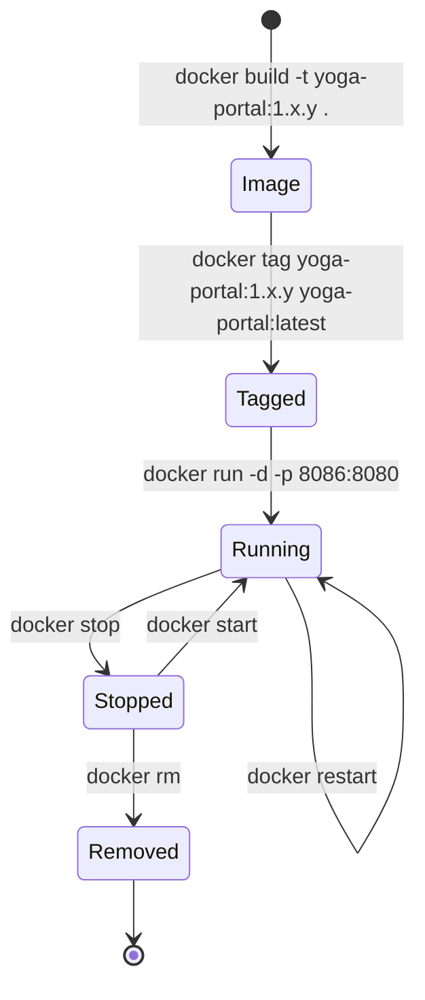

# Task 11 – Docker Image and Container Lifecycle

## Dockerfile

See [`Dockerfile`](../Dockerfile).

| Decision | Reason |
|---|---|
| Base `eclipse-temurin:21-jre` | Official, small JRE-only image for Java 21; multi-arch (Apple silicon + x86) |
| Copy the WAR built by Maven | One artefact is promoted from build to every environment; no rebuild inside Docker |
| `.dockerignore` allows only the WAR | Small build context and no source or secrets in the image |
| Non-root `yoga` user | Least privilege |
| `HEALTHCHECK` on `/actuator/health` | `docker ps` shows *healthy* or *unhealthy* |
| `APP_ENVIRONMENT` env var | The same image runs in any environment |

## Lifecycle

| Step | Command |
|---|---|
| Build | `docker build --build-arg APP_VERSION=1.1.0 -t yoga-portal:1.1.0 .` |
| Tag | `docker tag yoga-portal:1.1.0 yoga-portal:latest` |
| List / inspect image | `docker images yoga-portal` · `docker image inspect yoga-portal:1.1.0` · `docker history yoga-portal:1.1.0` |
| Run with port mapping | `docker run -d --name yoga-lifecycle -p 8086:8080 -e APP_ENVIRONMENT=docker-lifecycle yoga-portal:1.1.0` |
| Check | `curl localhost:8086/api/version` · `docker ps` |
| Logs | `docker logs --tail 25 yoga-lifecycle` |
| Inspect container | `docker inspect yoga-lifecycle` · `docker stats --no-stream yoga-lifecycle` |
| Stop / start / restart | `docker stop …` · `docker start …` · `docker restart …` |
| Remove | `docker stop yoga-lifecycle && docker rm yoga-lifecycle` |

The whole sequence is scripted in [`scripts/docker-lifecycle.sh`](../scripts/docker-lifecycle.sh). It writes every command and its
output to a log file, which is the *Docker command log* deliverable.
