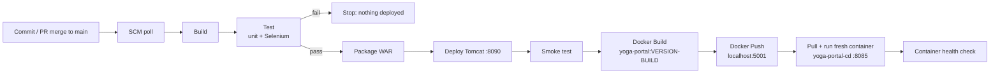

# Task 12 – Jenkins → Docker Continuous Deployment

The pipeline from Tasks 8–10 now continues after the Tomcat deployment:

| Item | Value |
|---|---|
| Image name | `localhost:5001/yoga-portal` |
| Version tag | `<pom version>-<Jenkins build number>`, e.g. `1.1.0-7`, plus `latest` |
| Registry | Local Docker registry (`registry:2`) on `localhost:5001`. Set the `REGISTRY` parameter to `docker.io/<user>` to use Docker Hub instead (after `docker login`). |
| Registry evidence | `curl http://localhost:5001/v2/_catalog` and `/v2/yoga-portal/tags/list`; also archived as `image-info.txt` in each build |
| Deployed container | `yoga-portal-cd`, published on http://localhost:8085, `APP_ENVIRONMENT=<env>-docker` |
| Freshness | Each run pulls the new tag, removes the old container and starts a new one |
| Gate | Docker stages run only after *Test* and the Tomcat smoke test pass |

End to end: **commit → GitHub → Jenkins poll → build → Selenium → WAR → Tomcat → image → registry → container**,
with no manual steps.
