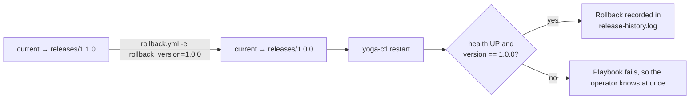

# Task 14 – Automated Provisioning and Reliability Validation

Run everything with one command from the repo root:

```bash
scripts/provision-node.sh <log-dir>
```

| Step | What happens | Evidence (log file) | Expected result |
|---|---|---|---|
| 0 | A **clean** `ubuntu:24.04` node is created (no Java, no Python) | `00-clean-node.log` | `java/python3: not installed` |
| 1 | **First execution**: provision packages, user, folders, files and service; deploy 1.0.0 | `01-first-run.log` | `failed=0`, many `changed` |
| 2 | Deploy release 1.1.0 | `02-upgrade-1.1.0.log` | only the artefact, symlink and restart change |
| 3 | **Idempotency**: re-run with identical inputs | `03-idempotency.log` | `changed=0` |
| 4 | **Health check** from the host | `04-health-check.log` | `{"status":"UP"}`, version 1.1.0 |
| 5 | **Rollback** to the previous stable release | `05-rollback-to-1.0.0.log` | version 1.0.0, health UP |
| 6 | **Recovery**: process killed (`kill -9`), then `site.yml` re-applied | `06-recovery.log` | DOWN → playbook restarts it → UP |
| 7 | Roll forward to 1.1.0 | `07-roll-forward-1.1.0.log` | version 1.1.0, health UP |

## How rollback works



## Reliability results

| Check | Target (Task 1 success criteria) | How it is verified |
|---|---|---|
| Idempotency | `changed=0` on the second run | `03-idempotency.log` PLAY RECAP |
| Health | `UP` after every change | `uri` task with retries in every playbook |
| Rollback time | ≤ 2 min | Duration of `05-rollback-to-1.0.0.log` (symlink switch + JVM start ≈ 15–30 s) |
| Recovery | Service restored without manual steps | `06-recovery.log` |
